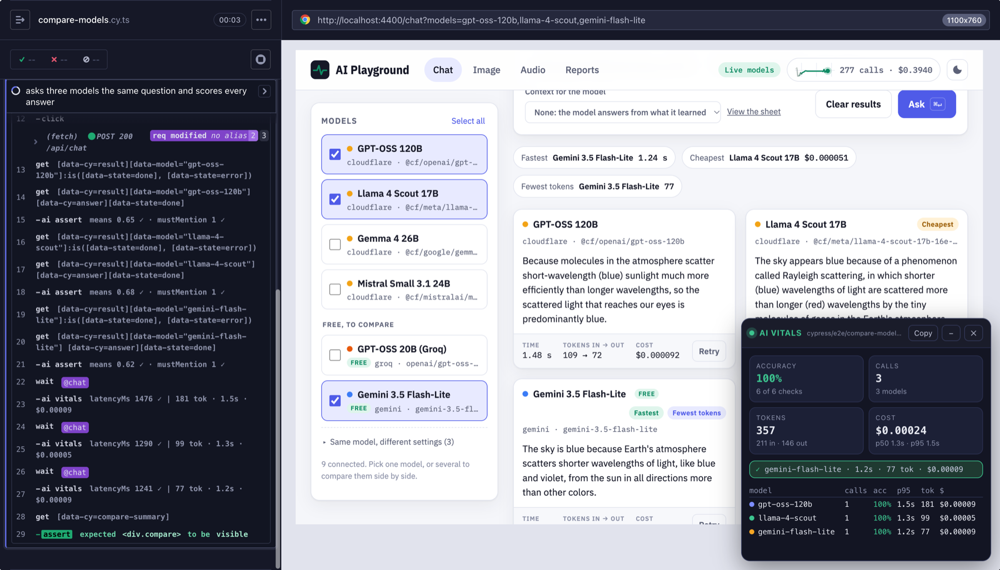
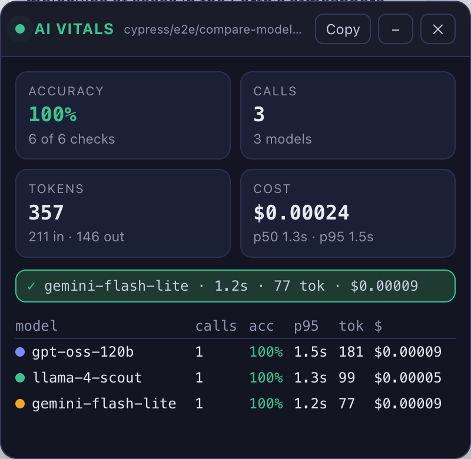
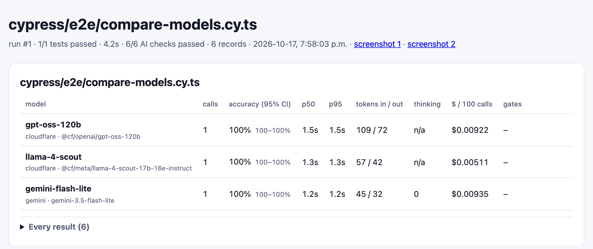

# cypress-ai-vitals

[](https://www.npmjs.com/package/cypress-ai-vitals) [](https://github.com/anvitech12/cypress-ai-vitals/actions/workflows/ci.yml) [](LICENSE) 

**Test the AI in your app with Cypress.** Check what an answer means, what an image shows and what a voice says, and see the tokens, time and cost of every model call.



Want to try it first? Clone the [demo app and its tests](#try-the-demo).

## What it does

- **Checks meaning, not exact words.** "The capital is Washington, D.C." and "Washington, D.C. is the USA's capital" both pass. "New York is the capital" fails.
- **Checks images and speech too.** What a picture shows, its brand colours, and how many words a voice got wrong.
- **Shows what every call costs.** Tokens, time and dollars appear in the Command Log, a live panel in the runner, the terminal and an HTML report.
- **Compares models.** Ask several models the same questions and rank them on accuracy, speed and cost.
- **Works with any model, and keeps CI cheap.** Cloudflare, OpenAI, Anthropic, Gemini, Groq, Ollama and more. Record answers once, then replay them in CI with no network and no spend.

## Quick start

### 1. Install

```bash
npm i -D cypress-ai-vitals
```

Needs Cypress 16+ and Node 22+. That one package includes everything, including a local AI runtime that runs the meaning, grounding, image and speech checks on your machine at no cost per call. It adds about 470 MB to `node_modules`, and the models themselves (about 330 MB) download the first time a check uses them.

### 2. Add the plugin to your Cypress project

Add these lines to your existing Cypress files. New to Cypress? Run `npx cypress open` once and it creates them. The examples are TypeScript; in a JavaScript project, use the same code in `.js` files. TypeScript projects also need `typescript` installed and a `tsconfig.json` ([Cypress guide](https://docs.cypress.io/app/tooling/typescript-support)).

```ts
// cypress/support/e2e.ts
import { register } from 'cypress-ai-vitals';

register();
```

```ts
// cypress.config.ts
import { defineConfig } from 'cypress';
import { aiVitalsPlugin } from 'cypress-ai-vitals/plugin';

export default defineConfig({
  e2e: {
    baseUrl: 'http://localhost:3000', // your app
    setupNodeEvents(on, config) {
      return aiVitalsPlugin(on, config);
    },
  },
});
```

Then add these to `.gitignore`. The plugin keeps its downloaded models (about 330 MB) and its results and reports in them:

```gitignore
ai.env
.cache/
cypress/ai-vitals/
```

### 3. Put your keys and models in `ai.env`

The meaning, grounding, image and speech checks run locally and need no key, so you can skip this step and go straight to step 4. Keys are needed for `judge`, `aiGenerate`, `aiCompare` and the speech engines of model providers.

Create a file called `ai.env` next to `cypress.config.ts`. It holds two kinds of lines:

- **Keys:** one per provider, for example `GROQ_API_KEY=...`.
- **Models:** one per model you want to test, written `AI_MODEL_<NAME>=<provider>:<model id>`. Your tests use `<NAME>` in lower case.

```ini
# ai.env
GROQ_API_KEY=gsk_...
GEMINI_API_KEY=...

AI_MODEL_FAST=groq:openai/gpt-oss-20b          # tests call this one "fast"
AI_MODEL_GEMINI=gemini:gemini-3.5-flash-lite   # tests call this one "gemini"
AI_JUDGE=gemini                                # grades rubric checks
```

Then check that every model answers:

```bash
npx cypress-ai-vitals models --ping
```

```
fast    chat  groq:openai/gpt-oss-20b       key set (56 chars) → "OK" in 240ms, 114 tok
gemini  chat  gemini:gemini-3.5-flash-lite  key set (39 chars) → "OK." in 564ms, 10 tok
```

Keys are read only in Node. They never reach the browser, and they are redacted from reports. [Where to get each key](#getting-api-keys) is at the end.

### 4. Write a test

Save this as `cypress/e2e/chat.cy.ts`. `groundedIn` reads a fixture file, so first save the facts your app answers from as `cypress/fixtures/usa-facts.md`.

```ts
it('answers the capital question correctly', () => {
  cy.visit('/chat');
  cy.get('[data-cy=question]').type('What is the capital of the USA?');
  cy.get('[data-cy=ask]').click();

  cy.get('[data-cy=answer]').aiAssert({
    means: 'Washington, D.C. is the capital of the United States.', // same meaning, in any wording
    mustMention: ['Washington'],                                     // these words must appear
    groundedIn: { fixture: 'usa-facts.md' },                        // must agree with this source
  });
});
```

`groundedIn` catches made-up facts. Point it at the document your app answers from, such as a help-centre article saved as `cypress/fixtures/usa-facts.md`. No sentence of the answer may contradict it, and at least half of them must be supported by it.

The Command Log shows each check with its score, for example `means 0.96 ✓ · mustMention 1 ✓ · groundedIn 1 ✓`. Click a row for the details.

## Checks

### Text: `aiAssert`

Chain it off an element or a string: `cy.get(selector).aiAssert({...})` or `cy.wrap(text).aiAssert({...})`. On an element, it waits until the text has stopped changing before it scores, so a streamed or typed-out answer is checked only when it is finished. `waitForStableMs` sets how long the text must stay the same (750 by default; 0 scores straight away).

| Check | Passes when |
|---|---|
| `means` | The answer means the same as your sentence (similarity 0.8 or more). |
| `mustMention` | Every listed word or phrase appears. |
| `exactAnswer` | The final number or phrase matches. |
| `groundedIn` | No sentence contradicts your source text, and at least half the on-topic sentences are supported by it. |
| `maxWer` | At most this share of words differs from `reference` (word error rate). |
| `jsonSchema` | The answer is JSON with the right shape. |
| `regex`, `notRegex` | A pattern does, or does not, match. |
| `refusal` | The answer is, or is not, a refusal. |
| `guardrails` | No personal data (`no-pii`), no leaked system prompt (`no-prompt-leak`, with `canary`), no leaked reasoning (`no-reasoning-leak`). |
| `judge` | Another model scores the answer 1 to 5 against your `rubric` (passes at 4 by default). |

Similarity is not truth: "The capital of the United States is Washington State" scores 0.86 against the right answer and passes `means` on its own. `mustMention: ['D.C.']` catches it. Pair `means` with `mustMention`, and use `groundedIn` for made-up facts.

### Images: `aiImageAssert`

Chain it off an `` or an image URL. A relative URL is loaded from the page under test, so serve the image from your app.

```ts
cy.get('[data-cy=generated]').aiImageAssert({
  depicts: 'a cartoon fox riding a skateboard',
  notDepicts: ['a dog', 'a photograph of a real fox'],
  brand: { fixture: 'brand/fox.json' },
  judge: { rubric: 'Exactly one fox, riding a skateboard, flat illustration.' },
});
```

| Check | Passes when |
|---|---|
| `depicts`, `notDepicts` | The picture matches your description better than wrong ones (CLIP, run locally). |
| `brand` | Brand colours cover enough of the picture, forbidden colours do not, and it looks closer to your on-brand examples than your off-brand ones. |
| `dimensions` | Width and height are right. |
| `judge` | A vision model confirms details, such as how many objects there are. |

A brand file:

```json
{
  "palette": [{ "hex": "#fd8b05", "minCoverage": 0.03 }],
  "tolerance": 14,
  "forbidden": [{ "hex": "#1e3a8a", "maxCoverage": 0.15 }],
  "onBrand": ["brand/on-brand-1.jpg", "brand/on-brand-2.jpg"],
  "offBrand": ["brand/off-brand-1.jpg"]
}
```

### Speech: `aiAudioAssert`

Chain it off an `<audio>` element or an audio URL (a relative URL is loaded from the page under test). A listener model writes down what it hears, and the check counts the wrong words.

```ts
cy.get('[data-cy=speech]').aiAudioAssert({
  transcript: { expected: 'Your order ships tomorrow morning.', maxWer: 0.2, engine: 'whisper' },
});
```

`engine` is any transcription model from `ai.env`, or `local` for Whisper on your machine. Prefer `maxWer` over `means` for speech: one misheard name ("Cyprus" for "Cypress") is one wrong word, but it changes the meaning score a lot.

### Your app's own calls: `aiVitals`

Chain it off an intercepted request to check the time, tokens and cost of the call your app made:

```ts
cy.intercept('POST', '/api/chat').as('chat');
cy.get('[data-cy=ask]').click();
cy.wait('@chat').aiVitals({ latencyMs: 3000, totalTokens: 800, costUsd: 0.001 });
```

It reads token usage from the response body (OpenAI, Anthropic and Gemini shapes) or an `x-ai-usage` header, and the time from `Server-Timing: model;dur=…`, falling back to the browser's timing.

### Call a model directly: `aiGenerate`

```ts
cy.aiGenerate('fast', 'What is the capital of the USA?').aiAssert({ mustMention: ['Washington'] });
cy.aiGenerate('flux', 'An orange fox mascot', { task: 'image' }).aiImageAssert({ depicts: 'an orange fox' });
```

### Compare models: `aiCompare`

```ts
cy.aiCompare({
  dataset: 'golden/qa.jsonl',   // or cases: [{ input, expected }]
  models: ['fast', 'gemini', 'claude'],
  runs: 2,
  gates: { accuracy: 0.75, p95LatencyMs: 4000 },
});
```

Each case is `{ input, expected?, answer?, mustMention?, groundedIn?, rubric? }`, and the matching checks run on their own. The report ranks the models and plots accuracy against cost:

| model | runs on | accuracy | p95 | tokens in/out | $/100 calls |
|---|---|---|---|---|---|
| ★ mistral-small | cloudflare · mistral-small-3.1-24b | 100% | 1.7s | 536/161 | $0.0017 |
| llama-4-scout | cloudflare · llama-4-scout-17b | 100% | 2.7s | 684/299 | $0.0027 |
| gpt-oss-20b | groq · openai/gpt-oss-20b | 94% | 517ms | 1628/1278 | $0.0032 |

The winner has the highest accuracy, then the lowest cost, then the lowest p95.

### Answers that vary: pass rates

Models do not answer the same way twice. Record checks with `soft: true`, then gate on how many passed:

```ts
for (let i = 0; i < 5; i++) {
  askTheBot().aiAssert({ means: 'Washington, D.C. is the capital.', soft: true, label: 'capital' });
}
cy.aiExpectPassRate('capital', 0.8); // at least 4 of 5
```

## Models and providers

Each `AI_MODEL_<NAME>=<provider>:<model id>` line adds a model. `AI_MODEL_GPT_OSS_20B` is `gpt-oss-20b` in your tests. Models are listed in the order you write them.

| Provider | Example line | Key |
|---|---|---|
| `cloudflare` | `cloudflare:@cf/openai/gpt-oss-120b` | `CLOUDFLARE_API_TOKEN`, `CLOUDFLARE_ACCOUNT_ID` |
| `openai` | `openai:gpt-6-luna` | `OPENAI_API_KEY` |
| `anthropic` | `anthropic:claude-sonnet-5-5` | `ANTHROPIC_API_KEY`, and `npm i -D @anthropic-ai/sdk` |
| `gemini` | `gemini:gemini-3.5-flash-lite` | `GEMINI_API_KEY` |
| `groq` | `groq:openai/gpt-oss-20b` | `GROQ_API_KEY` |
| `xai`, `mistral`, `deepseek`, `openrouter`, `together`, `fireworks`, `cerebras` | `xai:grok-4.7` | `<PROVIDER>_API_KEY` |
| `azure-openai` | `azure-openai:my-deployment` | `AZURE_OPENAI_API_KEY`, `AZURE_OPENAI_ENDPOINT` |
| `huggingface`, `hf-space` | `hf-space:black-forest-labs/FLUX.1-schnell` | `HF_TOKEN` (optional for Spaces) |
| `ollama`, `lmstudio`, `vllm` | `ollama:llama3.2` | none |
| `openai-compatible` | `openai-compatible:my-model` with `_BASE_URL` | `AI_MODEL_<NAME>_API_KEY` |

Cloudflare covers chat, images, voices and transcription. Whether a model chats, draws, speaks or listens is worked out from its id; set `_KIND` when it cannot tell.

**Per-model settings** go on extra lines with the model's name as a prefix:

```ini
AI_MODEL_FAST=groq:openai/gpt-oss-20b
AI_MODEL_FAST_LABEL=GPT-OSS 20B
AI_MODEL_FAST_TAGS=free
AI_MODEL_FAST_PRICE_IN=0.075      # USD per 1M input tokens
AI_MODEL_FAST_PRICE_OUT=0.30      # USD per 1M output tokens
AI_MODEL_FAST_REASONING_EFFORT=low
```

| Setting | What it does |
|---|---|
| `_LABEL`, `_TAGS` | Display name, and labels such as `free` |
| `_PRICE_IN`, `_PRICE_OUT` | USD per 1M tokens. Without a price, cost shows `n/a`. |
| `_PRICE_IMAGE`, `_PRICE_MINUTE`, `_PRICE_1K_CHARS` | USD per image, per audio minute, per 1,000 characters |
| `_TEMPERATURE`, `_MAX_TOKENS`, `_REASONING_EFFORT`, `_THINKING_BUDGET` | How the model answers |
| `_VOICE`, `_KIND` | Voice for speech models; `chat`, `image`, `speech` or `transcribe` |
| `_BASE_URL`, `_API_KEY`, `_HEADERS`, `_BODY` | Connection details and extra request fields |

<details>
<summary>More: any HTTP API, free Hugging Face Spaces, models in code, other settings</summary>

**Any JSON API**, with the `http` provider:

```ini
AI_MODEL_MINE=http:my-model
AI_MODEL_MINE_URL=https://example.com/v1/generate
AI_MODEL_MINE_BODY={"model":"{{model}}","input":"{{prompt}}"}
AI_MODEL_MINE_TEXT_PATH=output.0.text
AI_MODEL_MINE_INPUT_TOKENS_PATH=usage.input
AI_MODEL_MINE_OUTPUT_TOKENS_PATH=usage.output
```

**Free Hugging Face Spaces**, with the `hf-space` provider. The model is the Space id. Your prompt goes into the Space's `prompt` input, and `_BODY` overrides other inputs by name. Spaces share a daily GPU allowance: 2 minutes without a token, 5 with a free `HF_TOKEN`.

```ini
AI_MODEL_FLUX_SPACE=hf-space:black-forest-labs/FLUX.1-schnell
AI_MODEL_FLUX_SPACE_BODY='{"width":768,"height":768}'
```

**Models in code** win over `ai.env`:

```ts
aiVitalsPlugin(on, config, { models: { claude: { provider: 'anthropic', model: 'claude-sonnet-5-5' } } });
```

**Other `ai.env` settings:** `AI_MODELS` (use only these names), `AI_JUDGE` (the model that grades rubrics), `AI_STT` (the default listener), `AI_MODE` (`live`, `record` or `replay`). Real environment variables win over the file, so CI can inject secrets.

</details>

## See the results

Run a spec as usual, or click it in `npx cypress open`:

```bash
npx cypress run --spec cypress/e2e/compare-models.cy.ts
```

While it runs, every check and model call gets a row in the Command Log with its score, time, tokens and cost. When it finishes, you get three things.

**1. A panel in the Cypress runner**, with accuracy, calls, tokens, cost, the latest call and a row per model:



**Copy** puts these numbers on your clipboard as Markdown, ready for a pull request or a chat. **−** minimizes the panel, and **×** closes it to a small pill you click to reopen. It disappears when you re-run, and it appears at the end of `cypress run` videos.

**2. A table in the terminal** (a few columns trimmed to fit here):

```
  AI Vitals: cypress/e2e/compare-models.cy.ts
  ┌───────────────────┬───────┬──────────┬──────┬──────┬───────────────┬─────────────┐
  │ model             │ calls │ accuracy │ p50  │ p95  │ tokens in/out │ $/100 calls │
  ├───────────────────┼───────┼──────────┼──────┼──────┼───────────────┼─────────────┤
  │ gpt-oss-120b      │ 1     │ 100%     │ 1.5s │ 1.5s │ 109/72        │ $0.00922    │
  │ llama-4-scout     │ 1     │ 100%     │ 1.3s │ 1.3s │ 57/42         │ $0.00511    │
  │ gemini-flash-lite │ 1     │ 100%     │ 1.2s │ 1.2s │ 45/32         │ $0.00935    │
  └───────────────────┴───────┴──────────┴──────┴──────┴───────────────┴─────────────┘
```

**3. An HTML report**, saved next to Cypress's videos and screenshots. Open it with:

```bash
open cypress/ai-vitals/reports/compare-models.cy.ts/latest.html
```



Every run is kept (`report-001.html`, `report-002.html`, and so on) with the spec's video and screenshots, and `cypress/ai-vitals/reports/index.html` lists every spec.

**For a whole run**, for example in CI, combine every spec into one report:

```bash
npx cypress-ai-vitals report   # writes run.html, summary.md and summary.json to cypress/ai-vitals/reports
```

In GitHub Actions, the summary also appears on the job page.

<details>
<summary>Panel options</summary>

| Option | What it does |
|---|---|
| `register({ panel: false })` | Turns the panel off |
| `register({ panel: { show: 'live' } })` | Updates the panel during the run instead of at the end |
| `register({ panel: { startCollapsed: true } })` | Starts minimized |
| `register({ panel: { position: 'bottom-left' } })` | Moves it (`bottom-right` by default, or `top-right`) |

</details>

## Record once, replay in CI

```bash
AI_MODE=record npx cypress run   # call the real models and save every answer
AI_MODE=replay npx cypress run   # replay the saved answers: no network, no cost
```

Recordings go to `cypress/fixtures/ai-cassettes`; commit them. A typical CI job:

```yaml
- run: npx cypress-ai-vitals warm   # download the local models once (~330 MB), and cache .cache/ai-vitals-models
- run: npx cypress run
  env:
    AI_MODE: replay
    AI_VITALS_RUN_ID: ${{ github.run_id }}   # parallel machines share one report
- run: npx cypress-ai-vitals report
```

## CLI

```
npx cypress-ai-vitals models [--ping]   # list models (keys masked); --ping calls each once, exits 1 if one fails
npx cypress-ai-vitals report [--all]    # merge the latest run (or every run) into run.html and summary.md
npx cypress-ai-vitals clean             # delete saved results and reports
npx cypress-ai-vitals warm              # download the local scoring models ahead of time
```

## Plugin options

`aiVitalsPlugin(on, config, options)`:

| Option | Default |
|---|---|
| `models` | none (merged over `ai.env`) |
| `envFile` | `ai.env`, then `.env` |
| `mode` | `AI_MODE`, then `live` |
| `judge` | `AI_JUDGE` |
| `stt` | `AI_STT`, then `local` |
| `cassetteDir` | `<fixturesFolder>/ai-cassettes` |
| `resultsDir`, `reportsDir` | `cypress/ai-vitals/results`, `cypress/ai-vitals/reports` |
| `specReports`, `keepReports` | `true`, `10` per spec |
| `modelCacheDir` | `.cache/ai-vitals-models` |
| `offline` | `AI_VITALS_OFFLINE=1`: fail instead of downloading models |
| `terminalSummary` | `true` |

The plugin uses Cypress's `after:spec` event. If you have your own `after:spec`, set `terminalSummary: false` and `specReports: false`, and run `npx cypress-ai-vitals report` instead.

## Security

- Keys are read only in Node, from `ai.env` or environment variables, and never sent to the browser.
- Any value whose name ends in `KEY`, `TOKEN`, `SECRET`, `PASSWORD` or `ACCOUNT_ID` is replaced with `[redacted]` in results, reports, recordings and error messages.
- Recordings store the model name, the prompt and the answer, never URLs or headers.
- Found a security problem? See [SECURITY.md](SECURITY.md).

## Good to know

- **Set thresholds from your own examples.** The local scoring models are small and fast, so a few real answers tell you where to set `means` and `groundedIn`.
- **Small models miss look-alikes.** `groundedIn` can pass "Washington State" for "Washington, D.C." and misses claims that start with "It". Pair it with `mustMention`. For images, list the likely mistake in `notDepicts` (for example `'two cats'`), or use `judge` to count.
- **Streaming answers:** `cy.intercept` sees a streamed response only when it ends, so check the finished answer on the page.
- **Judges vary:** an LLM judge can score the same answer differently twice. Replay mode makes CI verdicts repeatable.
- **Speech recognition in the browser needs Google Chrome.** Electron does not support it.
- **First run:** the local scoring models are about 330 MB. Run `npx cypress-ai-vitals warm` once, ahead of time.

## Getting API keys

| Provider | Get a key | Free tier |
|---|---|---|
| Cloudflare Workers AI | [dash.cloudflare.com](https://dash.cloudflare.com/profile/api-tokens) (token with Workers AI Read and Edit) | 10,000 neurons a day |
| Google Gemini | [aistudio.google.com](https://aistudio.google.com/apikey) | Yes (text to speech: 10 requests a day) |
| Groq | [console.groq.com](https://console.groq.com/keys) | Yes, rate limited |
| OpenAI | [platform.openai.com](https://platform.openai.com/api-keys) | No; billed separately from ChatGPT plans |
| Anthropic | [console.anthropic.com](https://console.anthropic.com/settings/keys) | No |
| xAI (Grok) | [console.x.ai](https://console.x.ai) | Promotional credits only |
| Hugging Face | [huggingface.co](https://huggingface.co/settings/tokens) | Spaces: a few GPU minutes a day |
| Ollama | runs on your machine | Free |

**Example: compare ChatGPT, Claude, Gemini and Grok.**

```ini
OPENAI_API_KEY=sk-...
ANTHROPIC_API_KEY=sk-ant-...
GEMINI_API_KEY=...
XAI_API_KEY=xai-...

AI_MODEL_CHATGPT=openai:gpt-6-luna
AI_MODEL_CLAUDE=anthropic:claude-sonnet-5-5
AI_MODEL_GEMINI=gemini:gemini-3.5-flash-lite
AI_MODEL_GROK=xai:grok-4.7
```

```ts
cy.aiCompare({
  models: ['chatgpt', 'claude', 'gemini', 'grok'],
  cases: [
    { input: 'What is the capital of the USA?', expected: 'Washington, D.C. is the capital of the United States.', mustMention: ['Washington'] },
    { input: 'A train leaves at 09:40 and arrives at 13:15. How many minutes is the trip? Number only.', answer: 215 },
  ],
  runs: 3,
});
```

## Try the demo

[cypress-ai-vitals-demo](https://github.com/anvitech12/cypress-ai-vitals-demo) is a small app with real models behind it (chat, images, voices and transcription) and a Cypress suite that uses every command in this README. The screenshots above come from it.

```bash
git clone https://github.com/anvitech12/cypress-ai-vitals-demo.git
cd cypress-ai-vitals-demo
npm install
cp ai.env.example ai.env   # then add your keys
npm run app                # the app, at http://localhost:4400
npm run cy:open            # the tests, in a second terminal
```

## Extending

```ts
import { defineScorer, defineProvider } from 'cypress-ai-vitals/plugin';

defineScorer({ name: 'polite', modality: 'text', run: (text) => ({ pass: /please|thank you/i.test(String(text)) }) });
// in a spec: .aiAssert({ custom: { polite: true } })

// call defineProvider before aiVitalsPlugin(on, config)
defineProvider('my-gateway', { async generate(model, request) { /* call your API, return { text, usage, latencyMs } */ } });
// in ai.env: AI_MODEL_X=my-gateway:some-model
```

## Compatibility

| | Tested |
|---|---|
| Cypress | 16.1.1 (works with `>=16.0.0`) |
| Node | 22 and 24 |
| Browser | Chrome (headed and headless) |
| OS | macOS and Linux. CI runs the unit tests and the Cypress specs in Chrome on Ubuntu. |

## Contributing

Issues and pull requests are welcome. See [CONTRIBUTING.md](CONTRIBUTING.md).

The repo has its own Cypress tests in `cypress/e2e/`. They run in CI on every pull request, with no API keys. Run them with `npm run test:e2e`.

## License

MIT, see [LICENSE](LICENSE).
